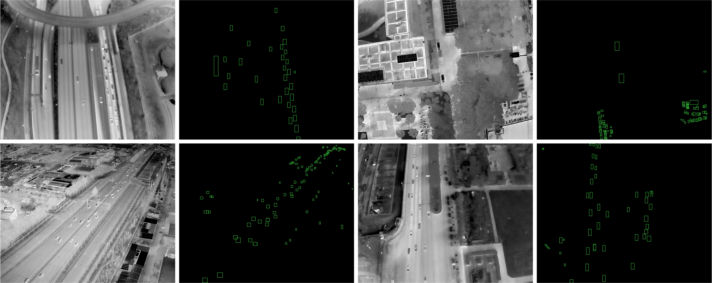
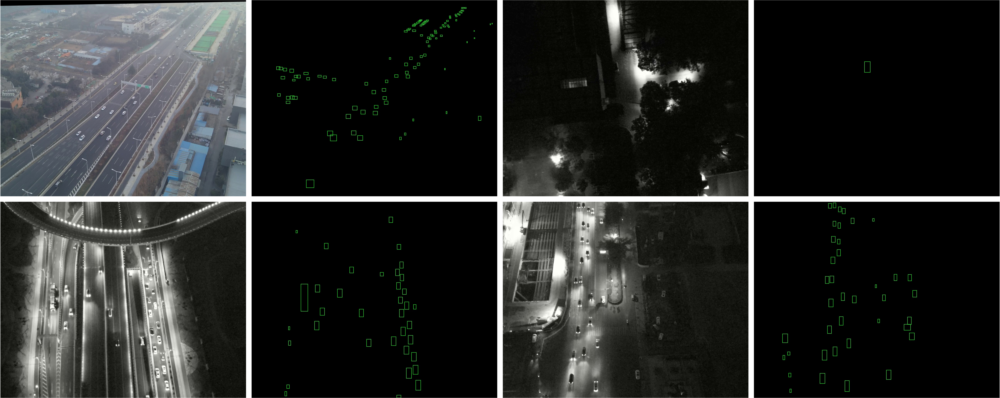

# DJI-ThermalVis: A Visible-Infrared Paired Dataset for Urban Adverse Condition Object Detection and Automatic Annotation Framework

##### Language: English | [Chinese](README.md)
This is the official implementation of the DJI-ThermalVis Dataset.

    

    

### Annotation Example

Thermal infrared image annotation example

    

可见光图像标注示例

    

### Dataset Access

Download link for the sample dataset is as follows:
[DJIThermalVis-Download](https://pan.baidu.com/s/1FIr0uQHjQx_6ldvM5bSBuw?pwd=hvkk)

The complete dataset will be made available gradually after the paper is published.

For the data access application form, see: [./data_access/Dataset Download Link Application Form.docx]

