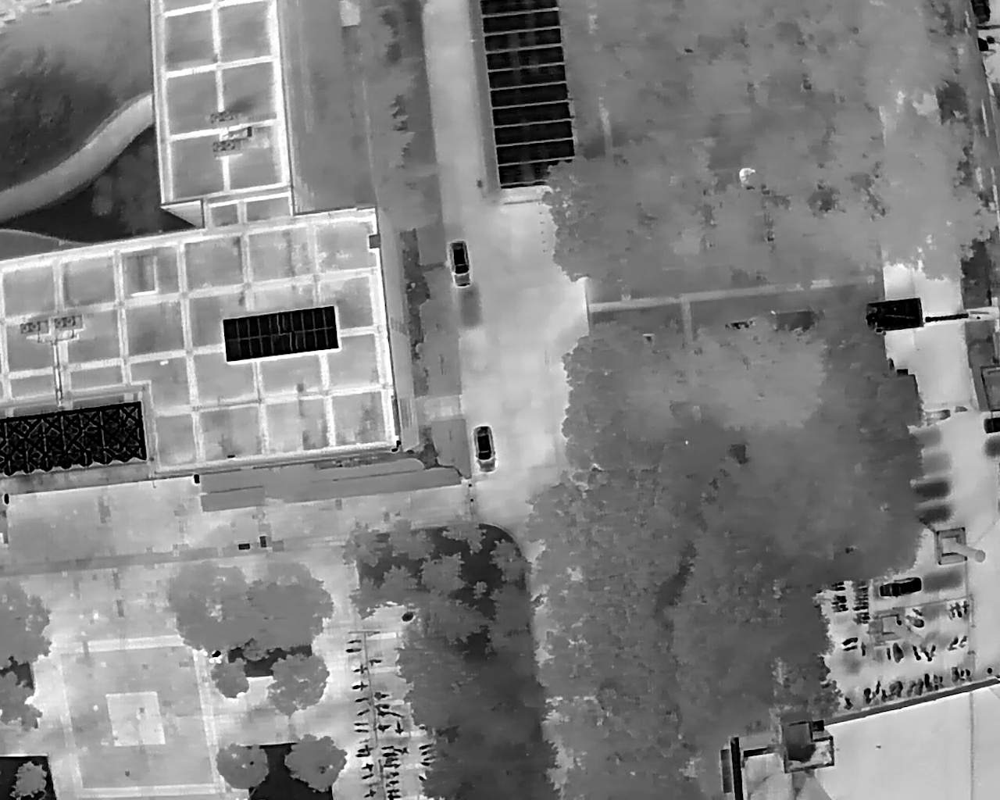
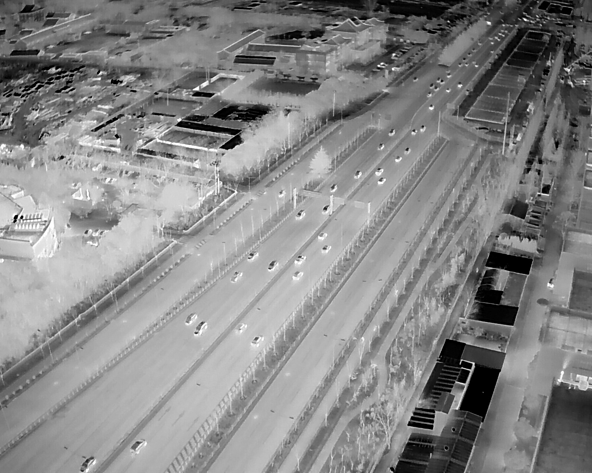

# DJI-ThermalVis：面向城市无人机载弱小目标检测的全时段多模态数据集

DJI-ThermalVis数据集的官方仓库。

    

    

### 标注示例

    

    

    

    

### 数据集获取

示例数据集文件下载链接如下：
https://pan.baidu.com/s/1FIr0uQHjQx_6ldvM5bSBuw?pwd=hvkk

完整数据集获取将在论文发表后陆续开放。
